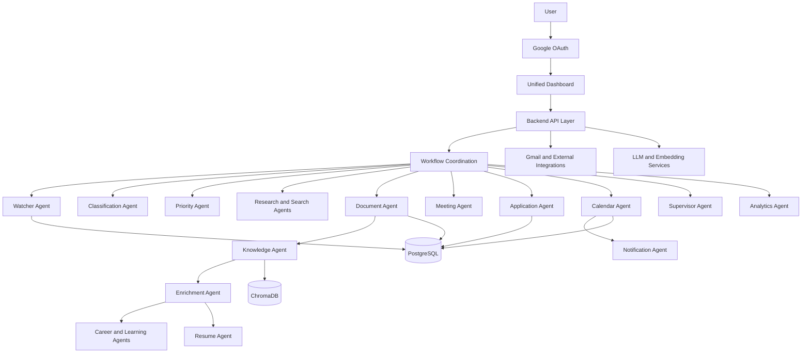

# OpteraAI
### Autonomous Multi-Agent AI Productivity Platform

**One Dashboard. Multiple Intelligent Agents. Automated Workflows.**

OpteraAI is an AI-powered productivity platform designed to help students and professionals manage emails, documents, meetings, learning, career opportunities, applications, schedules, and daily tasks from one unified dashboard.

Instead of treating every activity as a separate task, OpteraAI connects specialized AI agents that process information, share relevant context, and coordinate workflows to help users move from receiving information to taking action.

---

## Table of Contents

- [Overview](#overview)
- [Problem Statement](#problem-statement)
- [Objectives](#objectives)
- [Key Features](#key-features)
- [AI Agent Ecosystem](#ai-agent-ecosystem)
- [System Architecture](#system-architecture)
- [How It Works](#how-it-works)
- [Core Workflows](#core-workflows)
- [Technology Stack](#technology-stack)
- [Authentication and Security](#authentication-and-security)
- [Getting Started](#getting-started)
- [Environment Configuration](#environment-configuration)
- [Running the Application](#running-the-application)
- [Example Use Cases](#example-use-cases)
- [Limitations](#limitations)
- [Future Scope](#future-scope)
- [Project Impact](#project-impact)

---

## Overview

Students and professionals regularly handle information from emails, documents, online meetings, internships, hackathons, scholarships, job opportunities, certifications, and academic activities.

Managing these activities manually can lead to missed deadlines, repeated data entry, scattered information, and unnecessary effort.

OpteraAI addresses this problem through a unified multi-agent system. Each agent specializes in a particular responsibility, while APIs and shared data allow relevant information to move between connected workflows.

The platform aims to provide:

- A single dashboard for productivity activities.
- Intelligent email classification and prioritization.
- Document processing and personal knowledge retrieval.
- Context-aware career and learning assistance.
- Meeting support and action-item extraction.
- Automation for supported application forms.
- Calendar management and personalized notifications.
- Productivity analytics and agent monitoring.

**Domain:** Artificial Intelligence and Machine Learning  
**Application Area:** Productivity  
**Architecture:** Multi-Agent AI System

---

## Problem Statement

Users depend on several independent applications to manage their academic, professional, and personal productivity.

This fragmented approach creates several challenges:

- Important emails and opportunities can be overlooked.
- Users must manually identify categories, priorities, and deadlines.
- Information is scattered across documents, meetings, and online platforms.
- Resume and profile information must often be entered repeatedly.
- Meeting outcomes and follow-up tasks are difficult to track consistently.
- Career, learning, scheduling, and application activities remain disconnected.
- Switching between multiple tools increases the effort required to complete related tasks.

### Proposed Solution

OpteraAI brings these activities together through specialized AI agents and a unified dashboard. It processes incoming information, extracts relevant details, uses available personal context, and supports connected workflows with appropriate user authorization.

---

## Objectives

- Consolidate important productivity functions into one dashboard.
- Reduce repetitive information processing and manual data entry.
- Convert emails, documents, and meetings into structured information and actionable tasks.
- Reuse relevant personal context across knowledge, career, learning, and application workflows.
- Coordinate agents to execute multi-step productivity tasks.
- Improve deadline awareness through calendar integration and notifications.
- Provide visibility into activity, workflow status, and productivity.

---

## Key Features

### 1. Intelligent Email Processing

The Watcher, Classification, and Priority Agents process incoming email information.

- Synchronize supported Gmail data.
- Identify new emails and relevant metadata.
- Categorize emails by type.
- Determine urgency and importance.
- Identify deadlines, opportunities, and potential actions.
- Forward relevant information to downstream agents.

### 2. Automated Research and Information Extraction

The Research and Search Agents help transform incomplete or unstructured information into usable details.

- Extract important facts from incoming information.
- Identify deadlines, requirements, links, and action items.
- Search for additional information when needed.
- Retrieve and validate relevant information from available sources.
- Present structured findings through the unified dashboard.

### 3. Document and Knowledge Management

The Document and Knowledge Agents connect user documents with other productivity workflows.

- Process supported PDF and DOCX files.
- Extract text and document metadata.
- Organize documents and attachments.
- Index information for semantic retrieval.
- Retrieve relevant context from personal documents.
- Answer questions using available knowledge and retrieved context.

### 4. Personalization and Career Assistance

The Enrichment, Resume, Career, and Learning Agents support personalized workflows.

- Use relevant profile and opportunity information.
- Analyze resume content.
- Identify skill gaps and potential development areas.
- Recommend career paths, learning resources, and certifications.
- Support resume customization for opportunities.
- Help organize learning goals and career plans.

### 5. Meeting Assistance

The Meeting Agent supports authorized meeting workflows beyond basic transcription.

- Process supported meeting links.
- Capture or process meeting audio where configured.
- Generate transcripts and summaries.
- Extract action items and important discussion points.
- Retrieve relevant personal context.
- Generate responses using configured user information and instructions where supported.

Meeting participation and responses depend on platform capabilities, permissions, user authorization, and the configured implementation.

### 6. Application Automation

The Application Agent reduces repeated form-filling work.

- Use authorized profile and resume information.
- Identify fields in supported application forms.
- Map available information to relevant fields.
- Populate supported forms.
- Validate important information.
- Track application status and follow-up actions.

Application submission must respect website policies, user permissions, and applicable authorization requirements.

### 7. Smart Scheduling and Notifications

The Calendar and Notification Agents connect tasks, deadlines, and reminders.

- Manage relevant events and deadlines.
- Support meeting and task scheduling.
- Create reminders for important activities.
- Deliver dashboard or browser notifications where configured.
- Provide notification history and preferences.
- Support configurable notification sounds and quiet hours where implemented.

### 8. Analytics and Workflow Monitoring

The Analytics and Supervisor Agents provide visibility into system activity.

- Track productivity-related activities.
- Monitor workflow progress and agent status.
- Identify execution errors.
- Present activity metrics and reports.
- Support coordination between specialized agents.

---

## AI Agent Ecosystem

OpteraAI organizes its functionality into specialized roles.

| Agent | Primary Responsibility |
|---|---|
| Watcher Agent | Monitor incoming information and supported events |
| Classification Agent | Categorize emails and other information |
| Priority Agent | Determine urgency and importance |
| Research Agent | Extract structured findings and enrich information |
| Search Agent | Search for relevant information and sources |
| Document Agent | Process, classify, and manage documents |
| Knowledge Agent | Retrieve personal knowledge using RAG |
| Enrichment Agent | Add relevant context to profile and opportunity information |
| Resume Agent | Manage, analyze, and customize resumes |
| Meeting Agent | Support meetings, transcripts, summaries, and context-aware responses |
| Career Agent | Provide career guidance and identify skill gaps |
| Learning Agent | Create personalized learning plans |
| Application Agent | Automate supported application workflows |
| Calendar Agent | Manage events, deadlines, and schedules |
| Notification Agent | Deliver reminders and alerts |
| Analytics Agent | Track activity and generate productivity insights |
| Supervisor Agent | Coordinate workflows and monitor agent status |

The agents are designed to collaborate through structured task handoffs, APIs, and shared context rather than operating solely as isolated assistants.

---

## System Architecture

OpteraAI follows a modular architecture consisting of a unified frontend, backend APIs, specialized agents, shared data, a personal knowledge layer, and external integrations.



### Architecture Components

**Frontend:** Provides the main user interface and access to integrated productivity modules.

**Backend API Layer:** Handles application requests, business logic, authentication-related operations, and communication with services.

**Agent Layer:** Performs specialized tasks such as information processing, research, document handling, scheduling, and automation.

**Coordination Layer:** Routes tasks and coordinates interactions between agents.

**Data Layer:** Stores application information, user records, tasks, and workflow-related data in PostgreSQL.

**Knowledge Layer:** Supports semantic retrieval of relevant information using embeddings and a vector database.

**External Integrations:** Connects supported services such as Gmail, Google OAuth, and browser-based workflows.

---

## How It Works

A typical information-to-action workflow follows these stages:

```text
Incoming Information
        |
        v
Understand and Extract
        |
        v
Classify Information
        |
        v
Determine Priority
        |
        v
Research and Enrich
        |
        v
Select the Appropriate Agent
        |
        v
Execute an Authorized Action
        |
        v
Schedule and Notify
        |
        v
Track Activity and Results
```

Not every input requires every stage. The relevant agents and steps depend on the type of information and the requested task.

---

## Core Workflows

### Workflow 1: Internship Opportunity

```text
Gmail
  |
  v
Watcher Agent
  |
  v
Classification Agent
  |
  v
Priority Agent
  |
  v
Research Agent
  |
  +--> Company and Role
  +--> Eligibility and Skills
  +--> Deadline
  +--> Application Link
  |
  v
Unified Dashboard
  |
  v
Resume and Application Agents
  |
  v
Calendar and Notification Agents
  |
  v
Analytics
```

**Result:** Relevant opportunity information can be organized, researched, and connected to application preparation and deadline tracking.

### Workflow 2: Personal Knowledge Retrieval

```text
Document Upload
      |
      v
Text Extraction
      |
      v
Content Chunking
      |
      v
Embedding Generation
      |
      v
ChromaDB Vector Store
      |
      v
User Query
      |
      v
Semantic Retrieval
      |
      v
Relevant Context
      |
      v
AI-Generated Answer
```

**Result:** Users can retrieve information from their own supported documents instead of searching through files manually.

### Workflow 3: Meeting Assistance

```text
Authorized Meeting
        |
        v
Audio or Meeting Content
        |
        v
Speech Processing
        |
        v
Context Retrieval
        |
        v
Question and Topic Analysis
        |
        v
Context-Aware Response
        |
        v
Meeting Summary and Action Items
```

Meeting participation, audio processing, and responses depend on the configured services and permissions.

### Workflow 4: Application Automation

```text
Opportunity
     |
     v
Application Link
     |
     v
Read Authorized Profile and Resume
     |
     v
Identify Supported Form Fields
     |
     v
Map and Populate Information
     |
     v
Validate Fields
     |
     v
User Authorization, When Required
     |
     v
Submit Supported Form
     |
     v
Record Application Status
```

---

## Technology Stack

| Area | Technologies |
|---|---|
| Frontend | React.js, Vite, TypeScript, Tailwind CSS |
| UI Components | shadcn/ui, Lucide React |
| State and Animation | Zustand, Framer Motion |
| Data Visualization | Recharts |
| Backend | Python, FastAPI, Pydantic, SQLAlchemy, Uvicorn |
| Database | PostgreSQL |
| AI Services | Groq API, Gemini API |
| Embeddings | Sentence Transformers |
| Retrieval-Augmented Generation | ChromaDB, vector embeddings, cosine similarity |
| Browser Automation | Playwright |
| Meeting Processing | Whisper, FFmpeg |
| Document Processing | PyMuPDF, pdfplumber, python-docx, OCR where required |
| Authentication | Google OAuth, JWT |
| Email Integration | Gmail API |
| Scheduling | APScheduler |
| Deployment | Render, subject to environment configuration |

---

## Authentication and Security

OpteraAI is designed to use Google OAuth for supported account authentication and integrations.

Important security considerations include:

- Keep API keys, passwords, and OAuth credentials in environment variables.
- Never commit `.env` files or secret credentials to GitHub.
- Use `.env.example` to document required configuration without exposing real secrets.
- Restrict access to user-specific information.
- Validate data before performing consequential actions.
- Enforce appropriate user authorization for external submissions and meeting participation.
- Handle personal documents and profile data carefully.
- Record important workflow events where logging is configured.

AI-generated output should be reviewed where incorrect actions could have significant consequences.

---

## Getting Started

### Prerequisites

Install the following before running OpteraAI:

- Python 3.10 or later.
- Node.js version compatible with the installed Vite release.
- PostgreSQL, locally or through a hosted database.
- Git.
- Required API credentials for the features you intend to use.

### 1. Clone the Repository

```bash
git clone https://github.com/DharaniVasanV/OpteraAI.git
cd OpteraAI
```

### 2. Create a Python Virtual Environment

**Windows PowerShell**

```powershell
python -m venv .venv
.venv\Scripts\Activate.ps1
```

If PowerShell blocks script execution, activate the environment using an appropriate permitted method for your system.

**Linux or macOS**

```bash
python3 -m venv .venv
source .venv/bin/activate
```

### 3. Install Backend Dependencies

```bash
pip install -r requirements.txt
```

### 4. Install Playwright Chromium

```bash
playwright install chromium
```

Chromium is required for configured browser automation and supported meeting workflows.

### 5. Configure Environment Variables

Create your local environment file from the example:

**Windows PowerShell**

```powershell
Copy-Item .env.example .env
```

**Linux or macOS**

```bash
cp .env.example .env
```

Open `.env` and provide the credentials required by your configuration.

### 6. Install Frontend Dependencies

```bash
cd frontend
npm install
cd ..
```

### 7. Start the Application

**Windows PowerShell**

```powershell
.\start_all.ps1
```

**Linux or macOS**

```bash
chmod +x start_all.sh
./start_all.sh
```

The startup scripts are intended to launch the configured backend services and unified frontend together.

---

## Environment Configuration

Use `.env.example` as the source of truth for the exact environment variable names required by the project.

A sample configuration may include:

```env
DATABASE_URL=postgresql+asyncpg://<user>:<password>@localhost:5432/<db_name>

GROQ_API_KEY=your_groq_api_key
GROQ_API_KEY2=your_groq_api_key_2
GROQ_API_KEY3=your_groq_api_key_3

GEMINI_API_KEY=your_gemini_api_key

SMTP_USER=your_smtp_user
SMTP_PASSWORD=your_smtp_password
```

Configure the Gmail OAuth credentials and any other integration settings listed in `.env.example`.

**Important:**

- Replace all example values with your own credentials.
- Do not publish real keys, passwords, OAuth tokens, or database credentials.
- Multiple Groq keys should be configured only if supported by the application's key-rotation logic.
- Ensure the PostgreSQL database exists and is accessible before starting the application.
- Some features may remain unavailable until their external integrations are configured.

---

## Running the Application

Once the configured startup script completes, the documented local endpoints are:

| Service | URL |
|---|---|
| Unified Dashboard | `http://localhost:3000` |
| Central API Documentation | `http://127.0.0.1:9000/docs` |

These addresses assume the startup scripts use the ports described in the project configuration. If your local settings differ, use the ports displayed in the startup logs.

The API documentation page can help developers inspect and test the available backend endpoints.

---

## Example Use Cases

### Students

Manage academic documents, learning plans, meetings, internship opportunities, hackathons, deadlines, and reminders from a single platform.

### Job Seekers

Research career opportunities, organize resumes, prepare supported applications, and track application deadlines and follow-up actions.

### Working Professionals

Organize incoming information, prepare for meetings, retrieve personal knowledge, and manage schedules and tasks.

### Knowledge Workers

Search personal documents, connect research results with ongoing work, and reduce the effort required to locate relevant information.

---

## What Makes OpteraAI Different?

OpteraAI focuses on connecting productivity tasks rather than providing isolated AI features.

### One Dashboard

Access integrated productivity modules through a unified interface instead of navigating between separate agent dashboards.

### Shared Context

Allow relevant information from documents, profiles, meetings, and opportunities to support connected workflows.

### Coordinated Workflows

Connect information processing, research, applications, scheduling, and notifications through agent-to-agent task handoffs.

### From Information to Action

Support workflows that turn incoming information into structured results and authorized actions, rather than stopping at summaries or suggestions.

### Personal Productivity

Bring learning, career development, knowledge management, and day-to-day productivity into one platform.

---

## Limitations

- External APIs may enforce rate limits, quotas, or access restrictions.
- Browser automation can depend on changes to website layouts and form structures.
- Meeting participation varies by platform, permissions, and integration support.
- AI-generated responses may contain errors and require validation.
- Application automation is limited to supported workflows.
- Performance depends on model availability, database configuration, and system resources.
- Security and privacy depend on proper configuration, access controls, and credential management.

---

## Future Scope

Potential improvements include:

- Mobile application and push notifications.
- Support for additional email and calendar services.
- Additional meeting platforms.
- Expanded application portal integrations.
- Improved personal memory and knowledge retrieval.
- Multilingual interactions.
- Advanced voice-based workflows.
- More sophisticated agent orchestration.
- Improved productivity analytics and recommendations.
- Scalable deployment for more users and workflows.

---

## Project Impact

OpteraAI aims to reduce the time spent on repetitive digital activities such as sorting emails, searching through documents, preparing applications, managing deadlines, and tracking follow-up actions.

By connecting information processing with personal context and workflow automation, the platform seeks to help students and professionals focus more on learning, career development, and productive work.

The intended workflow is:

**Receive → Understand → Prioritize → Research → Organize → Act → Notify → Track**

---

## Conclusion

OpteraAI presents a unified approach to AI-assisted productivity by combining specialized agents, shared context, information retrieval, and workflow automation in one platform.

Its central goal is to transform scattered information into useful insights and coordinated actions, while keeping users in control of important decisions and external operations.

**OpteraAI: One Dashboard. Multiple Intelligent Agents. Automated Workflows.**
